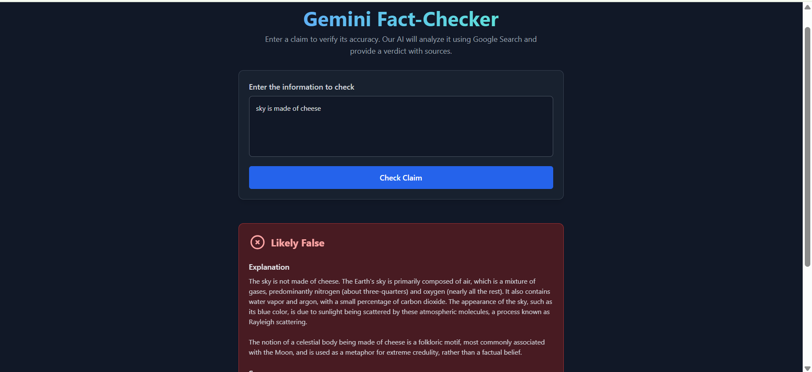
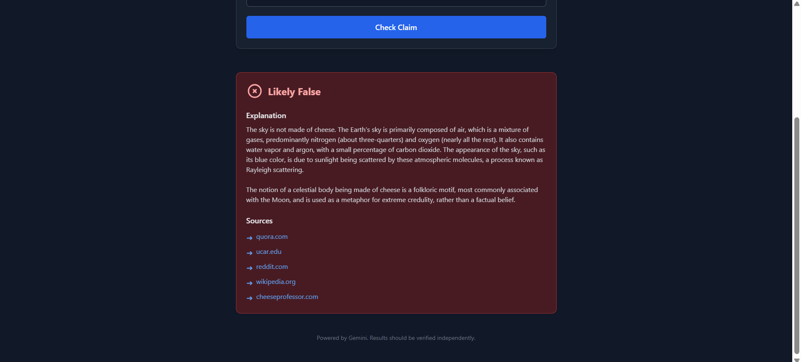

# Gemini Fact-Checker

A modern, AI-powered web application for fact-checking claims using Google Gemini API and real-time search results.

## 🎯 Overview

Gemini Fact-Checker is a React-based application that verifies the accuracy of user-provided claims by leveraging Google's Gemini AI model and Google Search integration. The app provides detailed fact-checking verdicts along with supporting sources and explanations.

**Key Features:**
- 🤖 AI-powered fact-checking using Google Gemini
- 🔍 Real-time Google Search integration
- 📊 Three-verdict system: LIKELY TRUE, LIKELY FALSE, or INCONCLUSIVE
- 📚 Source citations with links
- ⚡ Fast and responsive UI with Tailwind CSS
- 🎨 Modern, dark-themed interface

## 🛠️ Tech Stack

- **Frontend Framework:** React 19.2 + TypeScript
- **Build Tool:** Vite 6.2
- **AI Integration:** Google Generative AI (@google/genai)
- **Styling:** Tailwind CSS
- **Language:** TypeScript 5.8

## 📋 Prerequisites

- Node.js (v18 or higher recommended)
- npm or yarn
- Google Gemini API key

## 🚀 Getting Started

### 1. Install Dependencies

```bash
npm install
```

### 2. Configure API Key

Set your Gemini API key as an environment variable:

**Using `.env.local` file**
```
GEMINI_API_KEY=your_api_key_here
```

> Get your free API key from [Google AI Studio](https://ai.google.dev/)

### 3. Run Development Server

```bash
npm run dev
```

The app will start at `http://localhost:5173`

### 4. Build for Production

```bash
npm run build
```

### 5. Preview Production Build

```bash
npm run preview
```

## 📁 Project Structure

```
├── App.tsx                 # Main application component
├── index.tsx              # React entry point
├── index.html             # HTML template
├── types.ts               # TypeScript type definitions
├── vite.config.ts         # Vite configuration
├── tsconfig.json          # TypeScript configuration
├── package.json           # Project dependencies
├── components/
│   ├── ResultCard.tsx     # Fact-check result display component
│   └── icons.tsx          # SVG icons for UI
└── services/
    └── geminiService.ts   # Gemini API integration service
```

## 🔧 Key Components

### App.tsx
Main React component that handles:
- User input for claims to fact-check
- Loading states and error handling
- Display of fact-checking results

### geminiService.ts
Service module that:
- Initializes Google Gemini AI client
- Handles API communication with fallback models
- Parses AI responses into structured results
- Extracts sources from search results

### types.ts
TypeScript type definitions:
- `Verdict`: Enum for fact-check outcomes (LIKELY TRUE, LIKELY FALSE, INCONCLUSIVE)
- `Source`: Interface for citation sources
- `FactCheckResult`: Interface for complete fact-check response

## 💡 How It Works

1. User enters a claim in the input form
2. The claim is sent to Google Gemini with system instruction
3. Gemini performs Google Search using integrated tools
4. AI analyzes search results and provides:
   - A verdict (LIKELY TRUE/FALSE/INCONCLUSIVE)
   - Detailed explanation
   - Relevant sources with links
5. Results are displayed in a card component with proper formatting





## 🔐 Environment Variables

| Variable | Required | Description |
|----------|----------|-------------|
| `VITE_GEMINI_API_KEY` | Yes | Your Google Gemini API key |
| `GEMINI_API_KEY` | No | Alternative environment variable for API key |

## 🚨 Error Handling

The application includes comprehensive error handling for:
- Missing or invalid API keys
- Network failures
- API rate limiting
- Invalid user input

Errors are displayed to the user with helpful messages.

## 📦 Available Scripts

| Command | Description |
|---------|-------------|
| `npm run dev` | Start development server with hot reload |
| `npm run build` | Build for production |
| `npm run preview` | Preview production build locally |


## 📄 License

This project is available for educational and personal use.

## 🆘 Troubleshooting

**Issue: "GEMINI_API_KEY is not configured"**
- Ensure your API key is properly set in the environment variables
- Check that you're using the correct variable name (`VITE_GEMINI_API_KEY` for Vite)

**Issue: Slow responses**
- Initial requests may take longer as the API processes the claim
- Check your internet connection and API quota

**Issue: Build errors**
- Run `npm install` to ensure all dependencies are installed
- Clear the `node_modules` folder and reinstall if needed

